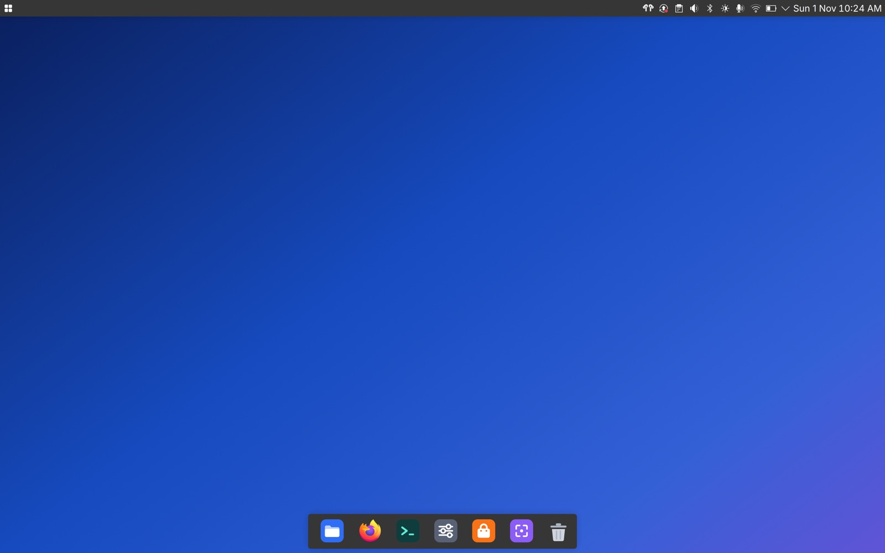
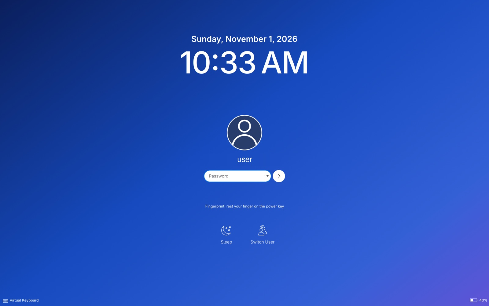
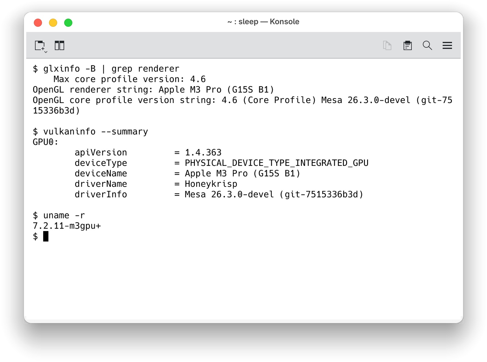
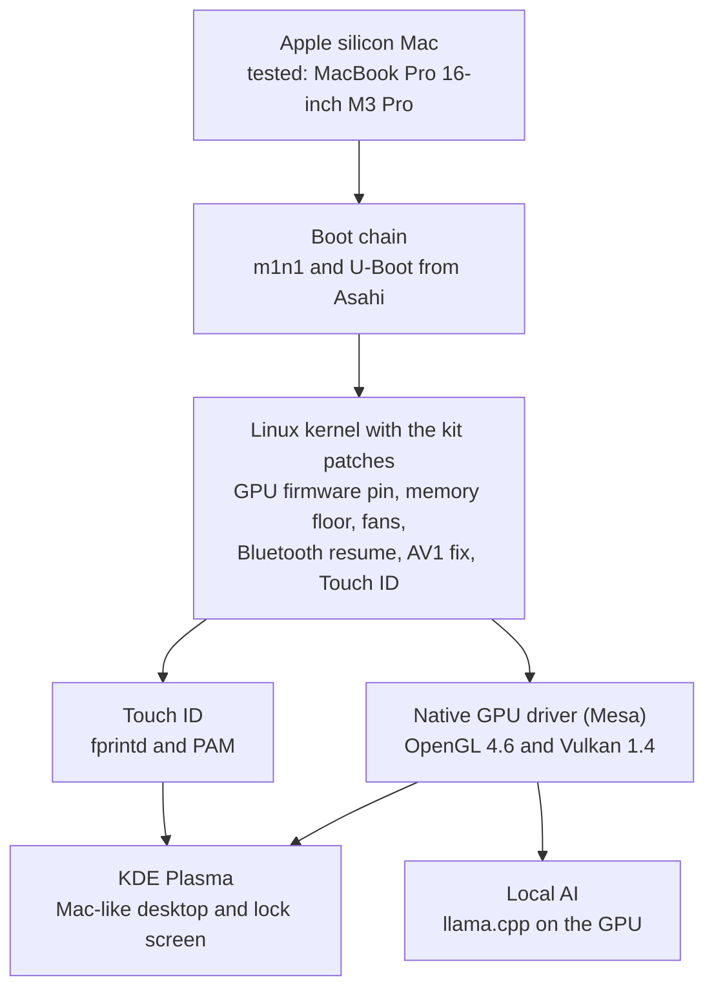

# Orchard

Extra drivers, fixes and a Mac-like desktop for Linux on Apple silicon Macs.

Orchard builds on Fedora Asahi Remix. It adds the native GPU driver stack, Touch ID, faster memory, hardware video decode, fan control and more. Each part comes with install scripts that you can undo, and with test results.

[](LICENSE)  

> **Unofficial.** Orchard is not part of Asahi Linux. The Asahi developers do not support it. Report problems in these repositories, not to Asahi.

<table>
<tr>
<td></td>
<td></td>
</tr>
<tr>
<td colspan="2" align="center"></td>
</tr>
</table>

## How it fits together



## The projects

| Repository | What it is | Start with |
|---|---|---|
| [apple-silicon-linux-kit](https://github.com/zainnobody/apple-silicon-linux-kit) | The main kit: the step-by-step guide, kernel and Mesa patches, install stages, Touch ID, tests | [GUIDE.md](https://github.com/zainnobody/apple-silicon-linux-kit/blob/main/GUIDE.md) |
| [apple-silicon-linux-desktop](https://github.com/zainnobody/apple-silicon-linux-desktop) | The `agx` installer for Fedora, Debian, Ubuntu and Arch, a kernel RPM build, and the Mac-like KDE desktop and lock screen | [README](https://github.com/zainnobody/apple-silicon-linux-desktop#readme) |
| [apple-silicon-neural-engine](https://github.com/zainnobody/apple-silicon-neural-engine) | Neural Engine research, and llama.cpp fixes for local AI on the GPU | [README](https://github.com/zainnobody/apple-silicon-neural-engine#readme) |

## What works

Tested on a MacBook Pro 16-inch M3 Pro (J516S) with Fedora Asahi Remix 44 and KDE Plasma.

| Area | Result |
|---|---|
| GPU | OpenGL 4.6, GLES 3.2 and Vulkan 1.4 on the native Mesa driver. KDE runs on the GPU. |
| Memory speed | About 130 GB/s instead of about 32 GB/s, with the memory floor patch |
| Touch ID | Unlocks the lock screen in about 1 s, with no key press, and works at the login screen. A wrong finger is refused. sudo stays password-only. |
| Video decode | H.264, HEVC, VP9 and AV1 in hardware |
| Displays and ports | HDMI, DisplayPort over USB-C, USB4 links |
| Fans | A kernel patch and a fan curve service. Without them the fans stay off. |
| Local AI | Llama 3.1 8B at 150 tokens/s prompt and 22.7 tokens/s generation on the GPU |
| Desktop | A top bar, a dock, flat icons, Meta+Space search, a flat lock screen |

Not done yet: sleep drains the battery, video encode uses the CPU, and the Neural Engine is research only. The full status table is in [the guide](https://github.com/zainnobody/apple-silicon-linux-kit/blob/main/GUIDE.md#3-status-of-each-feature).

## Get started

1. Read [Before you start](https://github.com/zainnobody/apple-silicon-linux-kit/blob/main/GUIDE.md#4-before-you-start) in the guide. Back up macOS, and rehearse the rollback.
2. Follow the [step-by-step guide](https://github.com/zainnobody/apple-silicon-linux-kit/blob/main/GUIDE.md#5-step-by-step). Each step has a verify check and an undo step.
3. Or let Claude Code do it with you: [connect a second Mac and paste the prompt](https://github.com/zainnobody/apple-silicon-linux-kit/blob/main/docs/claude-code-setup.md).
4. Check your install with the self-test: `tests/m3-selftest.sh` in the kit.

## Quick start

On the Mac that runs Fedora Asahi Remix, get the three projects side by side:

```bash
mkdir -p ~/apple-silicon-linux && cd ~/apple-silicon-linux
```

```bash
git clone https://github.com/zainnobody/apple-silicon-linux-kit.git agx-linux-kit
```

```bash
git clone https://github.com/zainnobody/apple-silicon-linux-desktop.git distro-pack
```

```bash
git clone https://github.com/zainnobody/apple-silicon-neural-engine.git ane-linux
```

See what your Mac supports and every install step, in order. These two commands change nothing:

```bash
distro-pack/agx detect
```

```bash
distro-pack/agx plan-install
```

Then follow [the guide](https://github.com/zainnobody/apple-silicon-linux-kit/blob/main/GUIDE.md#5-step-by-step). After each reboot and at the end, check the Mac:

```bash
agx-linux-kit/tests/m3-selftest.sh
```

## Let Claude Code help

Claude Code can run the guide with you from a second Mac. It runs the commands, checks each result and stops at every step that needs you. First [connect the second Mac over SSH](https://github.com/zainnobody/apple-silicon-linux-kit/blob/main/docs/claude-code-setup.md#option-a-connect-a-mac-to-the-m3). Then paste this prompt:

```text
Install Orchard (github.com/zainnobody/orchard) on my Apple silicon Mac that runs
Fedora Asahi Remix. It is reachable with `ssh m3`. Use the full prompt and rules in
docs/claude-code-setup.md of apple-silicon-linux-kit. Read GUIDE.md first and show me
a plan. Stop before every sudo command, every reboot and every Touch ID step.
Never ask for or type my password.
```

## Other Macs

Only the M3 Pro (J516S) is tested. Other Macs need a machine profile in the kit (`machines/`). Profiles are welcome with test results.

## Credits

Orchard is built on the work of the [Asahi Linux](https://asahilinux.org/) project and the community SiliconForest fork. Thanks to their developers.

## License

GPL-2.0 ([LICENSE](LICENSE)). Patches keep the license of the project they change. Each repository lists the details.
